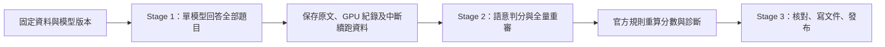

# HallusionBench 論文復現：用一張 8GB 顯示卡，檢查看圖模型是否真的看懂

> **先看結論：**本專案讓 InternVL3-2B 回答全部 1,129 題。依官方評分規則，單題成績為 **54.65%**；但把同一問題的各種條件放在一起，只有 **22.42%** 的控制組全部答對。這說明「有些題目答對」與「換一種問法、換一張修改圖仍答對」是兩件事。

這是 CVPR 2024 論文 **HallusionBench: An Advanced Diagnostic Suite for Entangled Language Hallucination and Visual Illusion in Large Vision-Language Models** 的評估流程復現，以及一個替代模型實驗。原作者為 Tianrui Guan、Fuxiao Liu 等人，來自 University of Maryland, College Park。

本次唯一完整推論模型是 **OpenGVLab/InternVL3-2B**，硬體是 **RTX 3070 Ti 8GB**。這裡保存了推論程式、真實回答、評分歷程、逐題診斷、八張分析圖及繁體中文文件。**沒有重跑原論文全部 15 個模型，也沒有把其他模型的文獻成績當作本機實驗。**

[原論文](https://openaccess.thecvf.com/content/CVPR2024/html/Guan_HallusionBench_An_Advanced_Diagnostic_Suite_for_Entangled_Language_Hallucination_and_CVPR_2024_paper.html) · [作者官方程式](https://github.com/tianyi-lab/HallusionBench) · [本次模型](https://huggingface.co/OpenGVLab/InternVL3-2B)

## 從哪裡開始看？

| 你想知道什麼 | 建議入口 |
|---|---|
| 五分鐘內知道做了什麼 | [給教授的重點摘要](docs/REPORT_TO_ADVISOR_zhTW.md) |
| 準備口頭報告，理解原論文 | [論文四大重點：摘要、目的、方法、成果](docs/PAPER_SUMMARY_zhTW.md) |
| 看本次的環境、實作與限制 | [復現完整整理](docs/REPRODUCTION_SUMMARY_zhTW.md) |
| 下載可閱讀的研究文件 | [繁體中文研究報告 PDF](reports/HallusionBench_Research_Report_zhTW.pdf) |
| 查每題如何得到分數 | [資料欄位與追溯範例](docs/DATA_GUIDE_zhTW.md) |
| 直接重新計算成績 | [不需要 GPU 的重算步驟](#只重算已保存的結果不需要-gpu) |

PDF 保留自行製作的八張統計圖；第三方案例原圖未再散布。六組案例仍有 Sample ID、回答、判分、圖片來源與雜湊，可回到固定來源查驗。原本本地的 20 頁 Stage 2 報告另已驗證，含第三方圖的版本沒有放進此發布版。

## 1. 這篇論文在研究什麼？

大型視覺語言模型，就是能同時處理圖片與文字的模型。你給它一張地鐵圖，再問「藍線能到五角大廈嗎？」它應該先讀圖，再回答。問題是，它可能記得真實世界的路線，於是即使圖片已把藍線和紅線互換，還是照記憶說「可以」。

HallusionBench 希望分辨兩種容易混在一起的失誤：

- **Language Hallucination（語言幻覺）**：模型沿用知識、慣用答案或語言線索，沒有適當依照當前圖像更新。例如看修改後地鐵圖，仍回答原本的路線。
- **Visual Illusion（視覺誤判）**：模型收到視覺輸入，卻把大小、文字、角度、圖例或影格順序讀錯。例如兩個實際一樣大的圓，因周圍圖形不同而被說成一大一小。

單看一個錯誤回答，通常無法知道是哪一種。作者因此建立原圖、修改圖與部分無圖條件的對照，再觀察同一模型如何改變答案。這些是依輸出與控制條件得到的**診斷分類**，不是直接讀到模型內部的想法。

## 2. 為什麼不能只看單題成績？

假設有三道相關題：原圖答對、修改圖答錯、無圖也沿用原答案。單題平均可能看起來還可以，但模型可能根本沒有注意圖片修改了哪裡。

另外，同一張圖問「兩條線一樣長嗎？」與「上面比較長嗎？」時，模型的答案也應該互相一致。若它同時說「一樣長」和「上面比較長」，只報某一題答對，就會漏掉這個問題。

所以本專案同時報單題、控制組與整張圖的成績。這些數字各回答不同問題，分母也不同。

## 3. 資料集與對照設計

| 資料 | 數量 | 白話說明 |
|---|---:|---|
| 問答項目 | 1,129 | 一次圖片／無圖條件搭配一個問題 |
| 實體影像 | 346 | 165 張原圖及 181 張人工修改圖 |
| Question Control Groups | 455 | 同一問題在相關條件下的回答放成一組 |
| Figure Groups | 346 | 同一張實體圖的相關問題放成一組 |
| 無圖／原圖／修改圖問答 | 178／447／504 | 這是題數，不能與圖片張數混用 |

**VD（Visual Dependent）**必須依賴圖像，例如圖中角度、圓大小與影格順序。**VS（Visual Supplement）**可能先靠常識回答，但圖片會補充或改寫資訊，例如地圖、人口表及名人演說文字。

九種子類別為 VD 的 Illusion、Math、Video、Poster、Figure，以及 VS 的 Chart、Table、Map、OCR。官方資料欄位把 Poster 寫成 VD/ocr；本專案保留原欄位並加上論文名稱對照。Video 使用預先排好順序的影格拼圖 PNG，沒有額外解碼影片。

## 4. 原論文的成果：Published Results

作者評估 15 種模型。Table 2 中 GPT-4V 的人工評分為 qAcc **31.42%**、All **67.58%**；GPT-4 輔助判分則為 qAcc **28.79%**、All **65.28%**。判分方式不同，兩列不能混成同一組數字。

| Published Results | 評分方式 | qAcc | fAcc | All |
|---|---|---:|---:|---:|
| GPT-4V（Oct 2023） | Human | 31.42% | 44.22% | 67.58% |
| GPT-4V（Oct 2023） | GPT4-Assisted | 28.79% | 39.88% | 65.28% |
| LLaVA-1.5 | GPT4-Assisted | 10.55% | 24.86% | 46.94% |
| Claude 3 | GPT4-Assisted | 21.76% | 28.61% | 56.86% |
| Qwen-VL | GPT4-Assisted | 5.93% | 6.65% | 39.15% |

Table 3 進一步分析 Yes/No 偏向、一致性及錯誤分類；Figure 4 顯示數學、錯覺與時序等題型的挑戰；Figure 5 用幾何、改圖及影格反轉案例說明問題。這些都是原作者的成果。摘要中「其他模型低於 16%」不能拿來蓋過 Table 2 的 Claude 3 qAcc=21.76%；這裡以正式表格的各列數值為準。

## 5. 本次完成了什麼？



Stage 1 只產生與保存回答，不讀標準答案做推論。Stage 2 由本對話的 GPT-6.1 判斷完整回答，再用官方純計算函數算成績。v2 已重審全部 1,129 題與 674 個配對；47 批初判、397 題歷史複核、仲裁及所有改動都保留。Stage 3 只整理與驗證，**沒有重新判分、改 GT 或執行 GPU 推論**。

GPT-6.1 Judge 不等同論文的 GPT-4 Judge。可以重現的是「從保存標籤算出相同數字」，不能保證另一個對話重新主觀判分會完全相同。

## 6. 本次環境與成本

| 項目 | 實際設定 |
|---|---|
| GPU | NVIDIA RTX 3070 Ti 8GB，單張 |
| CPU／RAM／OS | Intel Core i7-11700K／約 32GB／Windows 11 |
| Python／PyTorch | 3.12.14／2.7.1+cu128 |
| Transformers | 4.57.1 |
| 唯一完整推論模型 | OpenGVLab/InternVL3-2B |
| 模型 revision | 899155015275a9b7338c7f4677e19c784e0e5a21 |
| 精度與解碼 | BF16；無量化、無 CPU offload；batch=1；greedy；seed=42 |
| 輸入與輸出 | 448 像素動態切塊，最多 12 塊加縮圖；max_new_tokens=128 |
| 回答生成時間 | 合計 50.64 分鐘，不含安裝、下載、載入及中斷間隔 |

40 題達到輸出上限；不代表這 40 題自動錯誤，但理由可能被截斷。前 204 題的 reserved cache 曾記錄 9.576 GiB，因此不能說所有記憶體指標都從未超過 8GB。後續限制程序配置並逐題清快取；實體顯存每 20 秒取樣的最高值為 7,987 MiB。詳情保留在執行紀錄與來源報告。

## 7. 本次結果：Our Measured Results

| 指標 | 正確數／分母 | 成績 | 這個數字在問什麼？ |
|---|---:|---:|---|
| qAcc | 102／455 控制組 | **22.42%** | 同一問題換相關條件，能否整組都對？ |
| fAcc | 100／346 張圖 | **28.90%** | 同一張圖換相關問題，能否整圖都對？ |
| Easy | 251／455 控制組 | **55.16%** | 篩出非修改條件後，能否整組都對？ |
| Hard | 193／430 控制組 | **44.88%** | 篩出修改條件後，能否整組都對？ |
| All／aAcc | 617／1,129 題 | **54.65%** | 所有題目中，官方規則接受多少？ |

**Easy／Hard 是控制組成績，不能寫成一般逐題平均。** Hard 有 430 組，因為不是每個問題都有修改圖；同組若有多張修改圖，要全部答對才通過。

原始語意標籤為正確 **554**、錯誤 **412**、不確定 **163**。官方 VS 無圖特例又接受 **63** 筆語意 2，所以最終是 554+63=617。**54.65% 不代表模型在這些題目上都明確知道答案。**


### 同一張圖的回答是否一致？

| 類型 | 圖片數／346 | 占比 |
|---|---:|---:|
| 全部相關問題都對 | 100 | 28.90% |
| 部分對、部分錯 | 177 | 51.16% |
| 全部錯 | 69 | 19.94% |

超過一半圖片只有部分問題答對，表示單一問法的成功不夠代表穩定理解。

### 錯誤依控制規則分成哪幾類？

| 官方操作性分類 | 數量／512 個錯誤 | 占比 |
|---|---:|---:|
| Language Hallucination | 112 | 21.88% |
| Visual Illusion | 279 | 54.49% |
| Mixed | 121 | 23.63% |

這些是依 baseline、當前答案及配對關係得到的分類，**不代表已證明 54.49% 的失誤都來自純視覺感知**。Uncertain 是答案或配對不明確的狀態，不是表中額外的第四種成因。

官方程式的 Yes Percentage Difference 為 **0.1488**，FP Ratio 為 **0.6641**。它們使用 correctness 與 GT 反推，是代理統計。另直接讀回答立場：940 筆明確二元回答中，Yes 為 507／940=53.94%，同子集 GT Yes 為 399／940=42.45%，差 **0.1149**。兩種方法都顯示 Yes 偏向，但分母與定義不同。

### 八張圖表

| 圖表 | 閱讀重點 |
|---|---|
| [主要指標](stage2/figures/01_main_accuracy.png) | 單題與整組的差別 |
| [Easy／Hard](stage2/figures/02_easy_hard.png) | 兩者都是整組全對 |
| [原圖與修改圖](stage2/figures/03_original_edited.png) | 題目組成不同，不能直接當因果差距 |
| [Yes/No Bias](stage2/figures/04_yes_no_bias.png) | 官方代理與直接立場分開 |
| [Consistency](stage2/figures/05_consistency.png) | 同圖全部答對有多少 |
| [錯誤分類](stage2/figures/06_diagnostic_types.png) | 依控制規則分類 |
| [九種子類別](stage2/figures/07_subcategory_accuracy.png) | 類別題數也要一起看 |
| [與文獻並列](stage2/figures/08_published_comparison.png) | 年代與 Judge 不同，不能公平排名 |

## 8. 實驗結果與討論

**All 為什麼高於 qAcc？** All 每題各算一次；qAcc 要整組全對。一組三題答對兩題，All 得到兩個成功，qAcc 卻仍是零。兩者的差距反映跨條件穩定性不足。

**原圖與修改圖有什麼差別？** 原圖為 268／447=59.96%，修改圖為 236／504=46.83%。修改圖較低，但題目組成不同，不能說整個差距都是改圖造成的。另有按相同控制組比較與重抽樣分析，見[復現整理](docs/REPRODUCTION_SUMMARY_zhTW.md)。

**哪裡較弱？** Math 為 37／108=34.26%，Video 為 75／170=44.12%，Map 為 38／96=39.58%。可能涉及角度與幾何推理、影格先後、圖例與空間對照；目前只有輸出與控制結果，無法直接判定內部機制。

**常識是否壓過圖片？** 地鐵修改圖仍沿用原答案，是一個合理線索；Red Deer 被映射成 Red Bull，也呈現文字已讀到、解釋卻仍錯的情況。這些案例支持進一步研究，不足以單獨證明模型內部完全靠記憶。

六組真實案例、原文與 Sample ID 見[案例說明](docs/DATA_GUIDE_zhTW.md#六組案例)。沒有再散布第三方原圖；圖片下載後可用 manifest 核對。

## 9. 原論文與本次的差異

| 項目 | 原論文 | 本次 |
|---|---|---|
| 模型 | 15 種 | 唯一實測 InternVL3-2B |
| 硬體與版本 | 當時各模型設定 | 單張 RTX 3070 Ti 8GB，固定 revision |
| Judge | GPT-4 輔助，另有人類比較 | GPT-6.1 對話 Judge |
| 重複評分 | 多次評估取平均 | 初判、397 題歷史複核、v2 全量一致性稽核 |
| 外部人工驗證 | 原文有人工評分對照 | 本次沒有獨立人工驗證 |
| 統計 | 原文表格與診斷設計 | 重用官方純函數，保留逐題 trace |
| 圖片來源 | 原始資料來源 | 固定研究鏡像，核對 metadata 與 SHA-256 |

Figure 3 與官方程式有一個已知差異：VD 原圖答對、修改題答錯且回答相同時，圖示指向 LH，程式計為 Mixed。主結果沿用官方程式，替代分支另外列出。[完整差異紀錄](stage2/reports/METHOD_DIFFERENCES.md)

## 10. 如何重現？

### 只重算已保存的結果，不需要 GPU

使用 Python 3.12，在專案根目錄執行。這條路只讀既有標籤，不會重新要求模型判分。

```powershell
py -3.12 -m venv .venv-eval
.venv-eval/Scripts/python.exe -m pip install -r stage2/requirements.txt
.venv-eval/Scripts/python.exe -X utf8 -m unittest discover -s stage2/scripts -p test_metrics.py -v
.venv-eval/Scripts/python.exe -X utf8 scripts/verify_publication.py
.venv-eval/Scripts/python.exe -X utf8 stage2/scripts/compute_metrics.py
```

結果寫入 stage2/metrics/。驗證程式會把計算結果與已保存的最終標籤、固定分母及來源雜湊核對。自行重算的意思是從同一份標籤得到相同數值，不代表重新做一次主觀 Judge。

若想重畫八張圖：執行 stage2/scripts/build_figures.py。若想重建本發布版 PDF：執行 scripts/build_public_report.py；Windows 預設使用微軟正黑體。

### 重新進行單模型推論，需要相容 GPU

這是給想重新做實驗的人使用；發布階段沒有執行以下 GPU 指令。新實驗使用另一個 run_name，保護已保存的正式回答。

```powershell
./scripts/setup.ps1 -Python python
git clone https://github.com/tianyi-lab/HallusionBench.git upstream/HallusionBench
git -C upstream/HallusionBench checkout 744007c232c292942c7f80eb61edb2465482da31
.venv/Scripts/python.exe scripts/download_assets.py images
.venv/Scripts/python.exe scripts/prepare_data.py
.venv/Scripts/python.exe scripts/download_assets.py internvl3_2b
.venv/Scripts/python.exe scripts/verify_model.py
.venv/Scripts/python.exe -u scripts/infer.py --config configs/internvl3_2b_rerun.json --retry-failed
```

請讓 setup 使用 Python 3.12；系統若預設為其他版本，改填 Python 3.12 執行檔。模型下載固定 revision，trust_remote_code 使用該固定版本的官方程式。圖片先取官方來源，失敗則使用固定研究鏡像；下載後由 prepare_data 核對題目、GT、分組與圖片雜湊。沒有額外訓練或微調。

中斷後重跑同一 infer 指令，程式會略過該 run 已成功的項目；所有 attempts 保留。正式歷史資料的 run_name 是 internvl3_2b_bf16_tiles12，新跑的設定是 internvl3_2b_bf16_tiles12_rerun。

## 11. 資料放在哪裡？

```text
configs/                  原始設定與獨立重跑設定
scripts/                  下載、推論、續跑、來源驗證與發布版檢查
data/manifests/           問題、GT、控制分組、圖片 SHA-256
results/                  Stage 1 原始回答、CSV、attempts 及載入紀錄
logs/                     實際 GPU 監測與推論紀錄
handoff/                  官方參考碼、BSD 條款與 47 批判分輸入
stage2/judgments/         初判、歷史複核、仲裁與 v2 全量稽核
stage2/results/           最終標籤、診斷、配對及逐組成績
stage2/metrics/           所有 JSON／CSV 指標及敏感度
stage2/figures/           自行製作的八張圖
reports/                 研究 PDF、環境、來源、驗收及發布清單
docs/                    論文整理、復現整理、教授摘要與資料說明
```

主要追溯鏈：**sample_id → Stage 1 model_response_raw → Stage 2 semantic_correctness → 官方 final correctness → 逐組與逐圖指標 → 圖表**。所有原始模型回答、GT 與最終判分均保留；參考衝突與解釋問題不會靠刪題隱藏。

## 12. 限制與品質說明

- 32 題參考疑義，全部保留分母；這個指定集合的 All 極端範圍為 53.50%–56.33%，不是整體標註錯誤的信賴區間。
- 87 筆文內算術、邏輯或說明問題，另存 explanation_issue_flag；其中 20 筆仍依文字參考規則獲接受，主分數不保證完整解釋正確。
- 40 題輸出達上限；18 題為開放式題，直接 Yes/No 統計另排除。
- v2 是同一對話模型、舊標籤可見的全量一致性稽核。歷史 97.48% 是重讀一致率，不是判分準確率。
- 官方 Bias 使用代理極性；配對 uncertain 的 0／1 投影與 Figure 3 分支差異均另做敏感度。
- 圖片由固定研究鏡像取得，metadata 與官方一致；無法證明與已失效的原始 Drive 圖包逐位元相同。
- 不同年代、提示、Judge 與輸入設定不能直接公平排名；單模型結果也不代表所有 8GB 模型的上限。

## 13. Citation 與授權

原論文完整書目見 [CITATION.cff](CITATION.cff)。使用本專案時，請分別引用原論文與本次實驗，不把本次 Judge 或模型數字歸給原作者。

授權依來源分開處理，見 [LICENSE.md](LICENSE.md) 與 [THIRD_PARTY_NOTICES.md](THIRD_PARTY_NOTICES.md)。官方 HallusionBench 程式保留 BSD-3-Clause；模型附帶程式保留 MIT；模型卡及 Qwen 元件另有其條款。權重、Python 環境、快取、原始論文 PDF、第三方案例原圖及含這些圖的本地 PDF 未上傳。

兩份原始 ZIP 的 CRC、檔案雜湊及 20 頁本地報告已核對。[來源驗收](reports/stage3/source_audit.json) 記錄哪些內容完整保留、哪些診斷紀錄僅移除本機使用者目錄名稱，以及哪些圖片因權限未明而排除。原始封存 manifest 是來源憑證；實際發布檔案以 [發布清單](reports/publication_manifest.json) 為準。
