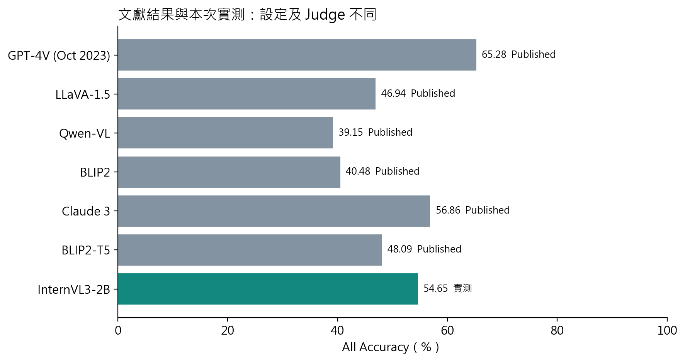

# 本次復現完整整理

## 1. 實驗範圍：只做一個真正能跑完的模型

本次使用 OpenGVLab/InternVL3-2B，在單張 RTX 3070 Ti 8GB 完成 HallusionBench 的 1,129 題。研究內容是評估既有模型，不是訓練新模型，也不是重新執行原作者的 15 個模型。

有些下載紀錄提到曾考慮的 Qwen 模型，那是前期候選下載，不是正式推論結果。正式成績的原始回答全部來自 InternVL3-2B；25 題 smoke test 另放，沒有混入 1,129 題分母。

## 2. 環境與設定

| 項目 | 設定 |
|---|---|
| GPU／CPU | RTX 3070 Ti 8GB／Intel Core i7-11700K |
| 記憶體／系統 | 約 32GB／Windows 11 |
| Python | 3.12.14 |
| PyTorch／Transformers | 2.7.1+cu128／4.57.1 |
| 模型 | OpenGVLab/InternVL3-2B |
| 固定版本 | 899155015275a9b7338c7f4677e19c784e0e5a21 |
| 精度 | BF16，無量化、無 CPU offload |
| 一次處理 | batch size 1 |
| 解碼 | greedy、seed 42、max_new_tokens 128 |
| 圖像輸入 | 官方 448 像素動態切塊，最多 12 塊加縮圖 |

回答生成時間合計 50.64 分鐘。這不含安裝、下載、模型載入及中斷間隔，所以不能把它當整個研究專案的總耗時。

前 204 題的配置器 reserved cache 曾記錄 9.576 GiB；tensor allocated 峰值為 5.471 GiB。之後保留 checkpoint，限制每程序配置比例 90% 並逐題清理閒置快取。生成設定未改。NVIDIA 以 20 秒間隔取樣的實體顯存最高 7,987 MiB，不能保證捕捉所有瞬間峰值。這些不同的記憶體數字應分開解讀。

## 3. 真正執行過的流程

**Stage 1：取得資料並產生回答。**固定官方題目、模型與圖片鏡像版本；核對 1,129 題、455 控制組與 346 圖；只把問題與圖片交給推論程式，GT 另外保存。推論逐題保存回答、token、圖塊數、參數、耗時、錯誤與 GPU 紀錄。程式支援中斷續跑，失敗與重試保留在 attempts。

**Stage 2：判分、計算與重審。**GPT-6.1 Judge 閱讀完整回答，不只取開頭 Yes/No。保存原始語意與立場，再套用官方 correctness 特例。47 批初判、397 題歷史複核、仲裁及 v2 全量 1,129 題／674 配對稽核全部保留。

**Stage 3：整理、驗收與發布。**核對兩份 ZIP 與本地成果，撰寫繁體中文文件與可散布的無第三方原圖 PDF，檢查連結、檔案追蹤、隱私及遠端內容。此階段不改原始回答、GT 或最終判分，也不重新執行 GPU。

## 4. 評分規則：先看回答，再套官方例外

原始語意為 1=不衝突文字參考、0=核心承諾或明確事實與參考衝突、2=模型回答本身不確定或矛盾。v2 以官方 gt_answer_details 為優先；二元 gt_answer 不變，衝突另標 reference_dispute。

主分數和解釋品質分開。例如參考只給 BOC=145，模型也答 145，但半角推導錯誤，主語意仍可為 1，另標說明問題。若參考明說一隻鴨，模型卻把多隻小雞都稱幼鴨，這是明確數量衝突，主語意為 0。

VS 無圖條件按官方程式接受語意 1 或 2。其他條件只接受 1。本次 554 個語意正確加上 63 個無圖特例，得到最終 617 個接受。這是分數增加的明確來源，不是額外發現模型知道了 63 題。

## 5. 結果與解釋

### 單題、控制組與整圖

| 指標 | 分子／分母 | 結果 |
|---|---:|---:|
| qAcc | 102／455 組 | 22.42% |
| fAcc | 100／346 圖 | 28.90% |
| Easy | 251／455 組 | 55.16% |
| Hard | 193／430 組 | 44.88% |
| All | 617／1,129 題 | 54.65% |

一組三題中兩題對，All 會計入兩次成功，但 qAcc 不會算這組通過。All 高於 qAcc 的主要意義，就是模型在相關條件下不夠穩定。Easy 與 Hard 都先按條件篩選，再算控制組全對；它們不是分別對 625 與 504 題直接取平均。

### 原圖與修改圖

原圖 268／447=59.96%，修改圖 236／504=46.83%。直接差距為 -13.13 個百分點，但題目組成不同。

另外在同時具有原圖與修改圖的 422 個控制組，先平均各組修改變體，再等權比較：原圖 59.48%、修改圖 48.10%，差 -11.37 點。以 seed=20261021 按組重抽 2,000 次，描述性的 95% 百分位區間為 [-18.13,-4.26] 點。這仍不是跨資料集保證或嚴格因果估計。

### 哪些題型較弱？

Math 37／108=34.26%、Video 75／170=44.12%、Map 38／96=39.58%。幾何關係、先後順序、圖例及空間關係都可能造成困難。這些是根據題型與輸出的合理解釋，沒有直接觀測內部機制。

### Yes/No 偏向

官方代理 PctDiff=(652-484)／1129=0.1488；FP Ratio=340／512=0.6641。官方先由 correctness 與 GT 反推 Yes，不直接讀模型實際立場。

直接立場分析排除 18 題開放式題。在 1,111 個二元題中，yes 507、no 433、uncertain 104、ambiguous 67。940 個明確回答裡，Yes 53.94%，同子集 GT Yes 42.45%，差 11.49 個百分點。錯極性中的 FP 占比為 228／348=65.52%；傳統條件式 FPR 為 228／541=42.14%。

兩種版本都顯示 Yes 偏向，但不能把不同分母的數字互換。

### 一致性

346 張圖中，全對 100=28.90%、部分對 177=51.16%、全錯 69=19.94%。同圖部分對的比例最高，表示模型理解會受問法影響。官方平均圖內逐題比例 figure score=0.54456，與整圖全對率 fAcc 不同。

### 錯誤診斷

512 個錯誤分為 LH 112=21.88%、VI 279=54.49%、Mixed 121=23.63%。674 個配對關係為 same 287、different 232、uncertain 155。

主表將 uncertain 投影為 0。全部投影為 1 時，分類變為 LH 113、VI 278、Mixed 121，準確率不變。只把 Figure 3 的 VD 同答案錯誤分支改成圖示版本，會得到 LH 191、VI 279、Mixed 42；相較主版本有 79 個從 Mixed 移到 LH。這說明分支版本會明顯影響「哪種幻覺最多」的敘述。

VI 占比最高，只能說最多錯誤落入該控制規則分支；它可能同時包含辨識、推理、題意及拒答等因素。

## 6. 與原文模型並列，但不當成公平排名

本次 All 高於部分歷史模型的發表值，但模型年代、輸入設定、圖片來源及 Judge 都不同，無法因此聲稱 InternVL3-2B 一般能力優於它們。此圖的用意是提供文獻背景，而非建立新的受控排行榜。

## 7. 六組案例告訴我們什麼？

修改地鐵圖仍回答原藍線可到、Red Deer 被解釋成 Red Bull、圓大小被誤判、反轉穿衣影格仍說穿衣、利率圖先 No 後正文肯定，以及 No 起頭但實際棄答，分別顯示更新答案、OCR 映射、感知、時序、矛盾與棄答處理的重要性。

每組案例都有真實 Sample ID、原文及判定，見[資料說明](DATA_GUIDE_zhTW.md#六組案例)。第三方圖像未放進發布版；來源、相對路徑及 SHA-256 仍保留。

## 8. 可信度與限制

| 項目 | 已完成的處理 | 尚不能宣稱什麼 |
|---|---|---|
| 原始資料 | 1,129 題 ID、原文、GT 與封存雜湊核對 | 鏡像與失效原圖包逐位元相同 |
| 語意 Judge | v2 全量重審，保留歷史標籤與理由 | 獨立人工驗證或黃金標註 |
| 參考疑義 | 32 題另列，保留分母及上下界 | 其他題一定沒有問題 |
| 說明問題 | 87 筆旗標，20 筆主分仍接受 | 全部贅述事實已外查 |
| 輸出截斷 | 40 題標記及複核 | 長度限制完全無害 |
| 開放式題 | 18 題區分 question_type | 全部題目都是一般 Yes/No |
| 診斷 | 官方分支與替代敏感度分列 | 直接證明模型內部成因 |

32 題疑義全設錯／全設對時，All 為 604–636／1129=53.50%–56.33%。這是指定集合的極端範圍，並非整體標註誤差的信賴區間。

歷史 397 題的語意重讀一致率 97.48%，只表示同模型兩次常給相同標籤，不能當準確率。v2 舊標籤可見，仍可能受錨定影響；沒有獨立人類或其他 Judge 的對照。

## 9. 可重現到什麼程度？

不用 GPU 就能重算已保存標籤的全部成績與圖表。這是決定性的資料處理：相同輸入標籤應得到相同分數。

重新推論則需要自行下載固定模型與圖片，並另用新 run_name；新機器、程式庫或硬體可能使輸出不同。重新請 GPT-6.1 主觀評分也可能不同，所以本專案保存實際使用過的判定，不把不同對話的再判定稱為保證一致。

主要入口：[README 重現步驟](../README.md#10-如何重現)；版本差異：[完整方法紀錄](../stage2/reports/METHOD_DIFFERENCES.md)；數值：[overall.json](../stage2/metrics/overall.json)。
