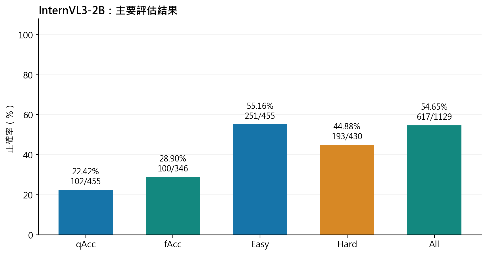
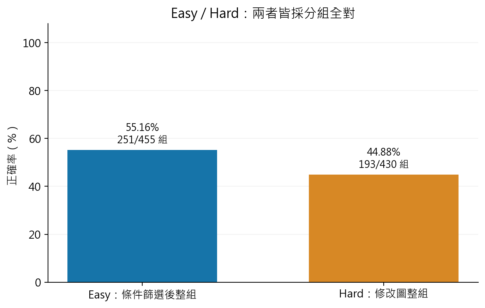
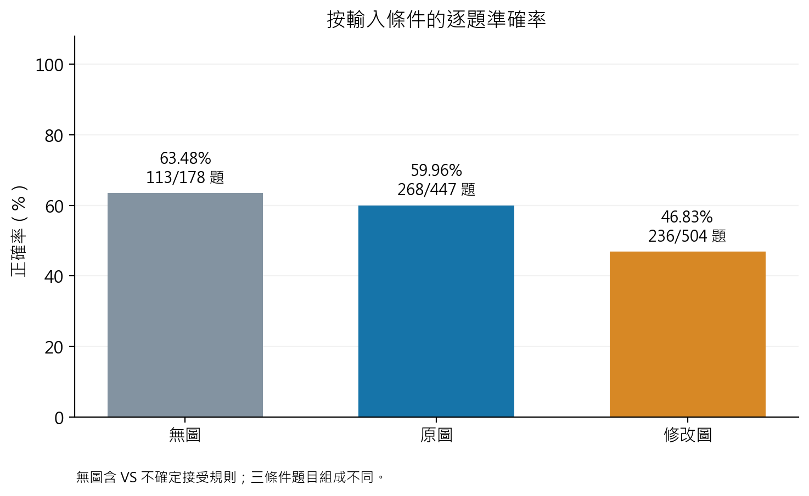
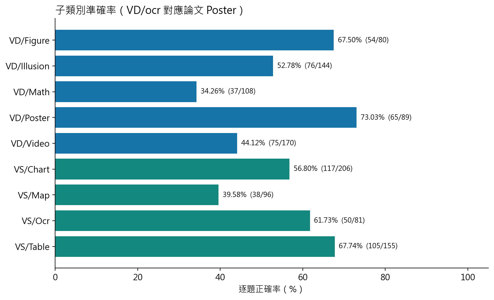
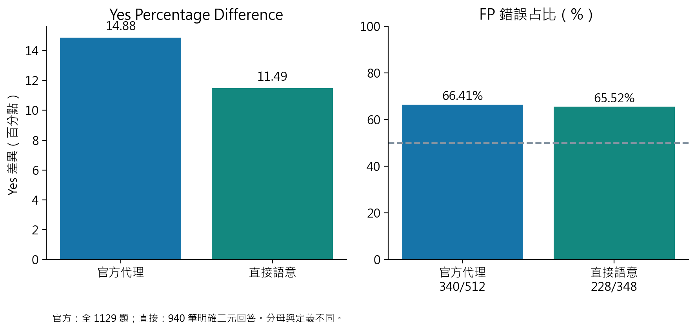
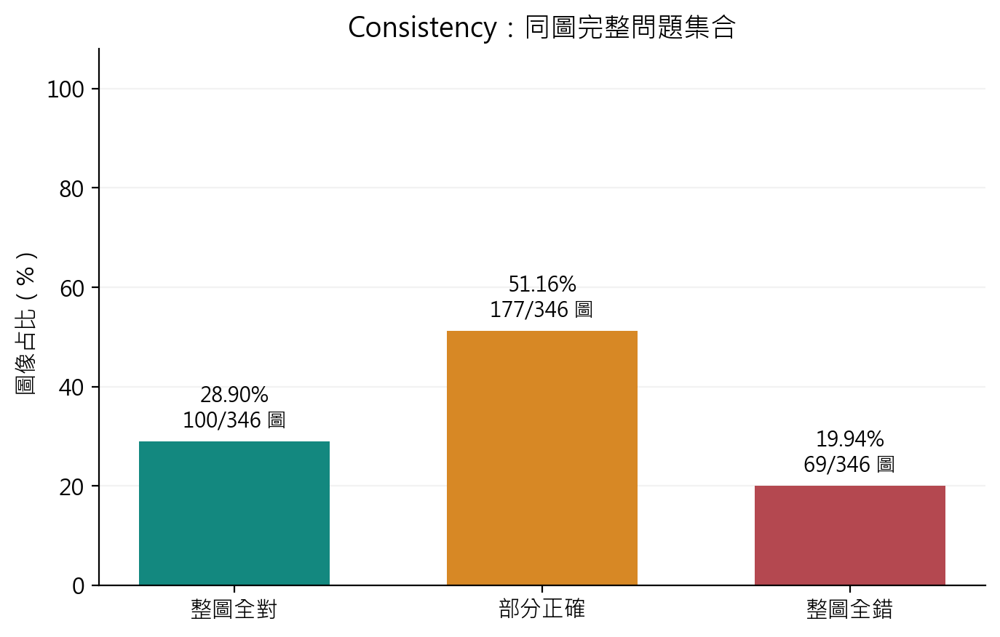
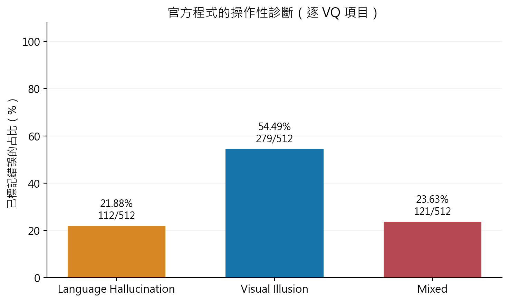

> 發布版說明：第三方案例原圖因再散布權限未明而省略；八張自製分析圖保留。此文保留 Stage 2 的研究內容與歷史狀態，新 PDF 以根目錄 README 為準。

# HallusionBench 第二階段實驗報告
## 單張 8GB GPU / InternVL3-2B / GPT-6.1 Judge

資料版本：2026-10-21，v2 全量一致性重審版。唯一實測視覺模型：OpenGVLab/InternVL3-2B。初判 1,129 題，歷史複核 397 題；本次再逐題閱讀全部 1,129 筆完整回答並重審 674 個配對，47 批皆保存。未完成判分 0 題；已知參考疑義 32 題另列。沒有重跑視覺模型或呼叫付費 Judge API。

主要結果：qAcc 102/455 = 22.42%；fAcc 100/346 = 28.90%；Easy 251/455 = 55.16%；Hard 193/430 = 44.88%；All 617/1129 = 54.65%。主分數表示相對官方文字參考的判定，再套用官方 VS 無圖例外；不是整段解釋都正確的比率。

## 一、論文摘要

HallusionBench 將視覺模型「看錯」與「依語言常識回答」交織的失誤放入控制實驗。資料包含 1,129 個視覺問答項目、455 個 Question Control Groups 與 346 張實體影像。Visual Dependent（VD）必須依賴影像；Visual Supplement（VS）可用無圖條件測試原有知識，再用原圖與修改圖檢驗視覺證據是否改變回答。

本報告依論文第 4、5 節、Table 2、Table 3 及 Figure 3、4、5，復用官方計算函數。重點是整組及整張圖是否都答對，而非只報一個逐題平均。Language Hallucination（LH）、Visual Illusion（VI）與 Mixed 是依控制條件得到的操作性分類，不是對模型內部機制的直接觀測。

## 二、研究目的

在單張 RTX 3070 Ti 8GB 的既定硬體內，評估一個可實際完成的本地視覺語言模型。使用者已將範圍明確縮為單模型，因此不重現原論文全部 15 種模型，也沒有將只下載的 Qwen 候選權重算作實驗。比較的其餘模型均是論文已發表結果。

本階段回答三個問題：單題答對能否代表跨條件與同圖一致；修改圖是否造成額外失誤；哪些失誤可由官方控制流程分類。研究結論限於此資料集、此推論設定與此 Judge，不外推為所有任務或模型年代的公平排名。

## 三、研究方法

先重新驗證 Stage 1 ZIP 的 CRC、PACKAGE_MANIFEST 127 筆檔案大小與 SHA-256，以及 summary、index、GT、control groups、正式 responses、integrity report。實際核對 1,129 個唯一 Sample ID、455 組、346 圖、47 批、40 筆達上限；排除 smoke test、失敗嘗試與其他模型。另逐張核對本地 346 張影像雜湊。原始回答不覆寫。

每題先產生原始語意標籤 s∈{0,1,2}，依序表示錯誤、正確、不確定；再以未修改的 assign_correctness 產生 c∈{0,1}：VS 且 figure_id=0 時，s=1 或 2 均令 c=1；其餘情況僅 s=1 令 c=1。這是依官方程式實作的 Eq. (2) 特例。原始語意與最終 correctness 分欄保留。

qAcc = Σg[組內所有 c=1]/控制組數。fAcc = Σf[該圖所有 c=1]/實體圖數，排除 VS 無圖。Easy 先取 visual_input≠2、Hard 先取 visual_input=2，再各自按控制組全對計算。All = Σi c_i / 1129。官方函數 get_eval_fig 的 score=各圖題內正確比例平均，不能拿來當 fAcc。

官方程式以 AST 僅載入七個純計算函數，沒有 import 原檔中的 OpenAI 或執行網路請求。以不同條件、非等量修改圖、部分正確圖、未知例外與診斷分支的 8 項單元測試驗證，另用獨立分組計數核對實際資料分母。

## 四、原論文實驗與成果

原文 Table 2 的 GPT-4V 人工評分 All 為 67.58%，GPT4-Assisted 為 65.28%；LLaVA-1.5 為 46.94%，Qwen-VL 為 39.15%，BLIP2 為 40.48%（後三者均 GPT4-Assisted）。原文 Fig. 4 分析九種子類別，Fig. 5 以數學、錯覺與反序影格說明模型可能忽略修改資訊。這些敘述是文獻結果，非本次重新推論。

原文模型涵蓋閉源與不同大小的開源系統，不能期待所有系統在 8GB 本機重跑。原文 GPT-4 輔助判分多次平均，本次為現有 GPT-6.1 對話判分；Table 2、3 的歷史數字已逐格對照 PDF 第 7 頁（印刷頁 14381），沒有由百分比逆推出不存在的整數分子。完整比較表見第七、八節。

## 五、本次復現環境及模型

**本地實驗條件**

| 項目 | 實際設定 |
| --- | --- |
| 視覺模型 | OpenGVLab/InternVL3-2B；唯一完整推論模型 |
| 硬體 | NVIDIA RTX 3070 Ti 8GB；i7-11700K；約 32GB RAM；Windows 11 |
| 推論環境 | Python 3.12.14；PyTorch 2.7.1+cu128；Transformers 4.57.1 |
| 模型版本 | 899155015275a9b7338c7f4677e19c784e0e5a21 |
| 精度及解碼 | BF16，無量化／無 CPU offload；batch=1；greedy；seed=42；max_new_tokens=128 |
| 影像輸入 | 448 動態切塊，上限 12，加 thumbnail；eager attention；未用 FlashAttention |
| 推論成本 | 回答生成時間加總 50.64 分鐘；不含安裝、下載、載入及中斷間隔 |
| 輸出上限 | 40/1129 = 3.54%；完整原文與上限旗標保留 |

2B 級模型在此硬體確實完成全量推論，因此適合作為低顯存復現的可行基線。這不證明它是 8GB 條件的最佳模型。沒有同機比較其他候選，也沒有進行微調或為本測試調參。

Tensor allocated 峰值 5.471 GiB；前 204 題預設配置器的 reserved cache 曾記錄 9.576 GiB，故不能聲稱所有記憶體指標從未超過 8GB。第 205 題起限制每程序比例 90% 並逐題清快取；NVIDIA 每 20 秒取樣之實體顯存最高 7,987 MiB，取樣不保證捕捉所有瞬間峰值。此策略變更與程式版本均有逐題紀錄。

## 六、本次 GPT-6.1 Judge 方法

Judge 為本對話確認的 gpt-6.1-sol。每批閱讀完整題目、官方文字參考及全部 model_response_raw，程式只展示、驗證與保存對話 Judge 撰寫的判斷。v2 在全量重審前固定 RUBRIC_v2.md 及 SHA-256，舊標籤可見；屬同模型一致性稽核，不是獨立盲評或人工驗證。主語意採 gt_answer_details，對齊官方 teacher prompt；二元 gt_answer 不改動，欄位衝突另列。

predicted_stance 為 yes／no／uncertain／ambiguous。No 後表示資訊不足時是 uncertain；明確相反文字並存則 ambiguous。數字推理錯誤但語言結論清楚時，依其核心承諾及參考判 0/1。開放式國名、州名、月份題共 18 題，Yes/No 不適用，stance 用 ambiguous 表示不適用；另有 question_type 區分，不能與真正矛盾混算。

主標籤 1 是清楚且不衝突文字參考；0 是核心承諾或明確事實牴觸參考；2 是模型回答本身棄答、矛盾或指涉不明。純參考矛盾不再自動轉成 2。參考明確 No answer 或允許不知道時，正確棄答可為 1。參考中的明確數量、方向、實體也算判準；參考未涵蓋的額外推導不一律扣主分，而以 explanation_issue_flag 和 audit_note 另記。

**v1 歷史重讀一致率（不是判分準確率）**

| 檢查範圍 | 題數 | stance+語意一致 | 語意 0/1/2 一致 |
| --- | --- | --- | --- |
| 全部複核 | 397 | 374/397 = 94.21% | 387/397 = 97.48% |
| 預先隨機抽樣 | 113 | 110/113 = 97.35% | 113/113 = 100.00% |

113 題以 seed=20261021 在初判前固定抽出，約占 10.01%。複核聯集另含所有初判未知／矛盾、全部 40 筆達上限及已標記問題；每次顯示隱藏首輪標籤。兩輪共 23 筆 stance 或語意分歧，其中 10 筆語意分歧；仲裁後另有 2 筆因參考回答對象錯置而改為 2。共保存 25 筆仲裁紀錄。

以上是 v1 的歷史重讀一致率，97.48% 不代表判分準確率；兩輪可能重複同一偏差。v2 另完成全量一致性稽核，並保留每筆 affirmed/revised、原文摘要雜湊與跨批裁決。最終語意為正確 554、錯誤 412、不確定 163；立場 yes 507、no 433、uncertain 104、ambiguous 85（含 18 題開放式）。沒有獨立人類或全量三輪平均，不能據此估計真正標註準確率。

**v2 全量重審與舊版差異**

| 範圍／指標 | v1 | v2／處理 |
| --- | --- | --- |
| qAcc | 101/455 = 22.20% | 102/455 = 22.42% |
| fAcc | 99/346 = 28.61% | 100/346 = 28.90% |
| Easy | 250/455 = 54.95% | 251/455 = 55.16% |
| Hard | 191/430 = 44.42% | 193/430 = 44.88% |
| All | 616/1129 = 54.56% | 617/1129 = 54.65% |
| 重審範圍 | 397 題歷史複核 | 全部 1129 題及 674 配對 |
| 本次改動 | 保留原標註 | 13 題語意、2 組關係 |
| 解釋問題 | 未統一分欄 | 87 筆旗標；其中 20 筆主分接受 |
| 參考疑義 | 17 題 | 32 題，全部保留分母 |

邊界判例：BOC=145 的回答雖有錯誤半角推導，仍不牴觸只給最終角度的文字參考，主分 1、解釋另標錯；鴨子題明稱多隻而參考是一隻，屬明確參考衝突，主分 0。No 明確否定 r³、正文肯定 r² 時可辨識題目立場；No 與同一角度命題相反且未撤回時保留 2。這些規則及理由全部落盤，不以讓分數升高為目標。

僅接受原始語意 1 為 554/1129 = 49.07%。官方 VS 無圖特例再接受 63 題語意 2，使 All 成為 54.65%。接受的立場分布為 uncertain 47、ambiguous 16；作者程式接受所有 2，包含矛盾回答，因此不等同模型知道答案。

## 七、主要實驗成果

**本次 Table 2：分子與分母**

| 指標 | 正確數／分母 | 百分比 | 單位 |
| --- | --- | --- | --- |
| qAcc | 102/455 | 22.42% | 控制組 |
| fAcc | 100/346 | 28.90% | 實體圖 |
| Easy | 251/455 | 55.16% | 控制組 |
| Hard | 193/430 | 44.88% | 控制組 |
| All | 617/1129 | 54.65% | 單題 |

Easy 分母為 455 組，包含 625 個非修改條件項目；Hard 分母為 430 組，包含 504 個修改條件項目。部分控制組沒有修改圖，故 Hard 不等於 455；一組多張修改圖時須全部正確。這兩個百分比不能以 625 與 504 直接加權還原 All。

圖 1。All 遠高於 qAcc，表示不少控制組只在部分條件答對。

**對應原文 Table 2 的比較（%）**

| Model | qAcc | fAcc | Easy | Hard | All | Evaluation | 來源 |
| --- | --- | --- | --- | --- | --- | --- | --- |
| GPT-4V (Oct 2023) | 31.42 | 44.22 | 79.56 | 38.37 | 67.58 | Human | Published Result |
| GPT-4V (Oct 2023) | 28.79 | 39.88 | 75.60 | 37.67 | 65.28 | GPT4-Assisted | Published Result |
| LLaVA-1.5 | 10.55 | 24.86 | 49.67 | 29.77 | 46.94 | GPT4-Assisted | Published Result |
| Qwen-VL | 5.93 | 6.65 | 31.43 | 24.88 | 39.15 | GPT4-Assisted | Published Result |
| BLIP2 | 5.05 | 12.43 | 33.85 | 40.70 | 40.48 | GPT4-Assisted | Published Result |
| Claude 3 | 21.76 | 28.61 | 55.16 | 41.40 | 56.86 | GPT4-Assisted | Published Result |
| BLIP2-T5 | 15.16 | 20.52 | 45.49 | 43.49 | 48.09 | GPT4-Assisted | Published Result |
| InternVL3-2B | 22.42 | 28.90 | 55.16 | 44.88 | 54.65 | GPT-6.1 semantic + adjudication | Our Measured Result |

InternVL3-2B 的 All 54.65% 與文獻列並排。不同年代、推論設定、圖片來源與 Judge 下的差值，只是描述性比較，不能用作受控排名或小模型超越較大模型的一般性結論。

**VD 與 VS：各欄列正確／分母及百分比**

| 類別／題數 | qAcc | fAcc | Easy | Hard | All |
| --- | --- | --- | --- | --- | --- |
| VD/591 | 61/277 22.02% | 73/230 31.74% | 162/277 58.48% | 124/274 45.26% | 307/591 51.95% |
| VS/538 | 41/178 23.03% | 27/116 23.28% | 89/178 50.00% | 69/156 44.23% | 310/538 57.62% |

圖 2。Easy／Hard 為控制組指標，非單題條件平均。

圖 3。無圖 113/178；原圖 268/447；修改圖 236/504。

原圖逐題 59.96%，修改圖 46.83%，差 -13.13 個百分點；題目組成不同。另在 422 個同時有原圖及修改圖的控制組，先平均各組修改變體再等權比較：原圖 59.48%、修改 48.10%，差 -11.37 點。按組重抽 2,000 次的描述性 95% 百分位區間為 [-18.13, -4.26] 點；不是獨立逐題或跨資料集的因果保證。

**九個子類別逐題結果**

| 類別 | 正確／分母 | 百分比 |
| --- | --- | --- |
| VD/Figure | 54/80 | 67.50% |
| VD/Illusion | 76/144 | 52.78% |
| VD/Math | 37/108 | 34.26% |
| VD/Poster | 65/89 | 73.03% |
| VD/Video | 75/170 | 44.12% |
| VS/Chart | 117/206 | 56.80% |
| VS/Map | 38/96 | 39.58% |
| VS/Ocr | 50/81 | 61.73% |
| VS/Table | 105/155 | 67.74% |

圖 4。VD/ocr 在論文稱 Poster；VS/ocr 才是另一個 OCR 類別。

九類別中，Math 與 Video 仍屬此設定的較弱項；完整分子、分母及百分比見上表。樣本數不同，VS 也含無圖特例，不能當作純視覺感知能力排序。

## 八、Yes/No Bias 分析

官方 yes_ratio_stats 不直接讀回答：yes_proxy_i=1[c_i=gt_i]。PctDiff=(652-484)/1129=0.14880，即 +14.88 百分點。FP Ratio=340/512 = 66.41%；此處是錯誤項目中 gt=0 的比例，並非傳統 FP/(FP+TN)。

直接立場排除 18 題開放式題。在 1111 個二元題中：uncertain 104、yes 507、no 433、ambiguous 67。明確 yes/no 子集有 940 題，Yes 507/940 = 53.94%，同子集 GT Yes 399/940 = 42.45%；直接比例差 108/940=0.11489。錯極性中的 FP 占比 228/348 = 65.52%；條件式 FPR 228/541 = 42.14%。

官方與直接結果都呈 Yes 偏向，但分母與對未知的處理不同，不能互換。極性正確而關鍵解釋錯誤、VS 未知被接受、參考內部衝突，都可能使代理極性不等於實際立場。直接版本仍使用原始二元 GT，因此也受其錯置影響。

圖 5。兩種 Bias 統計各保留自己的分母。

**對應原文 Table 3 的比較**

| Model | PctDiff | FP | Correct | Incons. | Wrong | LH | VI | Mixed | 來源 |
| --- | --- | --- | --- | --- | --- | --- | --- | --- | --- |
| GPT-4V (Oct 2023) Human | 0.0660 | 0.6000 | 44.22 | 32.66 | 23.12 | 21.86 | 46.17 | 31.97 | Published |
| GPT-4V (Oct 2023) GPT4-Assisted | 0.0580 | 0.5800 | 39.88 | 38.15 | 21.97 | 22.19 | 45.66 | 32.14 | Published |
| LLaVA-1.5 | 0.2600 | 0.7500 | 24.86 | 45.38 | 29.77 | 26.71 | 51.09 | 22.20 | Published |
| Qwen-VL | 0.1200 | 0.6000 | 6.65 | 50.29 | 43.06 | 0.87 | 88.06 | 11.06 | Published |
| BLIP2 | 0.1800 | 0.6500 | 12.43 | 63.01 | 24.57 | 39.14 | 43.45 | 17.41 | Published |
| Claude 3 | 0.0630 | 0.5700 | 28.61 | 49.42 | 21.97 | 19.10 | 59.14 | 21.77 | Published |
| BLIP2-T5 | 0.0800 | 0.5800 | 20.52 | 59.54 | 19.94 | 41.64 | 40.44 | 17.92 | Published |
| InternVL3-2B | 0.1488 | 0.6641 | 28.90 | 51.16 | 19.94 | 21.88 | 54.49 | 23.63 | Measured |

PctDiff 為 [-1,1] 的比例差；FP 為 [0,1] 比例；其餘欄為百分比。Published Result 取自原文 Table 3；Measured 是本次實測。發表值已經過四捨五入，多 Judge 平均也未提供各輪整數計數，故不虛構其分子。

## 九、Consistency Test

同一實體圖全題正確為 Correct，部分正確為 Inconsistent，全錯為 Wrong。346 圖的結果：Correct 100/346 = 28.90%；Inconsistent 177/346 = 51.16%；Wrong 69/346 = 19.94%。三類互斥且完整，與兩段回答的 same/different 是不同指標。

圖 6。半數左右圖像只在部分提問答對，顯示單次問法不足以代表穩定理解。

官方 figure score 為 0.54456，是平均圖內逐題比例，不能代替 fAcc。控制組全對 102/455 與整圖全對 100/346 的成員及分母不同。

## 十、Language Hallucination 與 Visual Illusion 分析

674 個非 baseline 比較全部重審：same 287、different 232、uncertain 155。VD baseline 為原圖 figure_id=0，VS baseline 為無圖 figure_id=0。主版本將 uncertain 投影為 0，依原 parser 無法辨識時的預設值；投影不表示語意已確定 different。另列投影為 1 的結果。

**官方 Table 3 診斷：逐錯誤 VQ 項目**

| 類型 | 數量／錯誤總數 | 百分比 |
| --- | --- | --- |
| LH | 112/512 | 21.88% |
| VI | 279/512 | 54.49% |
| Mix | 121/512 | 23.63% |

512 個最終錯誤：LH 112、VI 279、Mixed 121。若彙整到失敗控制組，則為 LH 48/353 = 13.60%；VI 200/353 = 56.66%；Mix 105/353 = 29.75%。主 Table 3 採 evaluation.py 的逐 VQ 版本，兩種分母不互換。

圖 7。VI 的操作性占比最高，但此分類不能證明內部機制。

將全部 155 個 uncertain 投影為 1，診斷為 LH 113、VI 278、Mix 121；準確率不變。只將 VD「baseline 對、修改錯、same」分支按 Figure 3 改為 LH，得到 LH 191、VI 279、Mixed 42。主表仍沿用官方程式，圖示替代版本只列敏感度。

以下案例的判分先依文字 GT 完成，再實際檢視來源圖片進行說明；沒有用看圖後的直覺回改已固定標籤。十張展示影像均重新核對 SHA-256，保留來源原位元、拼圖順序及 provenance。

## 案例 A：修改地圖後仍沿用原答案

實際檢視兩張地鐵圖：原圖經 Pentagon 的路線為藍、黃；修改圖將紅藍對調，Pentagon 經過紅、黃線，藍線移到另一條路徑。模型在無圖、原圖、修改圖都回答藍線可到，沒有隨圖例與路線改變。

修改題的 baseline 無圖正確、現答錯且 same，官方操作性分類為 LH。這支持答案未依修改視覺證據更新；是否由參數記憶主導仍屬推測。

共同題目：According to the map, can I take the Blue Line towards the Pentagon on the DC Metro system?

**判定依據（模型文字為節錄；完整原文見 case_studies.json）**

| Sample ID／條件 | GT／語意／最終／診斷 | 模型回答 |
| --- | --- | --- |
| VS/map/6/0/0 / no_visual | 1 / 1 / 1 / none | Yes.  The Blue Line is part of the DC Metro system and runs through the Pentagon. |
| VS/map/6/1/0 / original | 1 / 1 / 1 / none | Yes. The Blue Line is marked on the map and runs towards the Pentagon. |
| VS/map/6/2/0 / edited | 0 / 0 / 0 / LH | Yes. The Blue Line is one of the lines shown on the map, and it runs towards the Pentagon. |

（來源圖未再散布：original；可依案例 metadata 取得。）
original / SHA-256 b94433b750a728cb6e1309f34d856f0586dd445bd15a9a02f52d839df955516f

（來源圖未再散布：edited；可依案例 metadata 取得。）
edited / SHA-256 93d6b7a55deadccb348a55a6e9b6244f5e2fc8c3a58ef08f816719c06cccabd1

展示圖維持來源位元；完整 SHA-256、來源路徑與檢視紀錄見 case_studies.json。原圖與修改圖順序如標籤。

## 案例 B：OCR 讀到新文字，品牌映射卻錯誤

原圖字樣為 Red Bull；修改圖清楚改成 Red Deer，兩隻紅牛圖形保留。模型修改題原文已抄出 Red Deer，仍宣稱該文字表示 Red Bull。

修改題語意 0；baseline 正確，但完整回答抄錄的名稱不同，same 判 different，官方歸 VI。不能僅憑品牌記憶的直覺改標 LH。這也揭示診斷依賴語意比較的尺度。

共同題目：According to the text given in the image, is this logo for Red Bull?

**判定依據（模型文字為節錄；完整原文見 case_studies.json）**

| Sample ID／條件 | GT／語意／最終／診斷 | 模型回答 |
| --- | --- | --- |
| VD/ocr/13/0/0 / original | 1 / 1 / 1 / none | Yes.  The logo in the image is clearly for Red Bull, as indicated by the text "Red Bull"""" below the bull imagery. |
| VD/ocr/13/1/0 / edited | 0 / 0 / 0 / VI | Yes.  The logo in the image is for Red Bull, as indicated by the text "Red Deer""""" (with the text "Red Deer""""" (with the text "Red Deer"""")" in the image). |

（來源圖未再散布：original；可依案例 metadata 取得。）
original / SHA-256 2555542c4ce1140b9905fcee0a2dd1f9c7932c42e976429a40af59d79fa53323

（來源圖未再散布：edited；可依案例 metadata 取得。）
edited / SHA-256 688aff092c4c835f7c057fc02c9e51ef09f67d8825363995539dc06f93b66fd8

展示圖維持來源位元；完整 SHA-256、來源路徑與檢視紀錄見 case_studies.json。原圖與修改圖順序如標籤。

## 案例 C：視覺錯覺與相同 No 的不同事實

實際檢視橙色圓圖：原圖兩中心圓等大，但周圍灰圓尺寸不同；修改圖右中心圓明顯加大。原答 No 並說右圓較小，修改答也為 No，但說右圓較大。

原圖語意 0、修改圖語意 1；兩段 No 不能當 same，因較小與較大相反。原圖失敗按官方分類為 VI。等大判準由官方參考支持，本案例未另做像素量測。

共同題目：Is the right orange circle the same size as the left orange circle?

**判定依據（模型文字為節錄；完整原文見 case_studies.json）**

| Sample ID／條件 | GT／語意／最終／診斷 | 模型回答 |
| --- | --- | --- |
| VD/illusion/0/0/0 / original | 1 / 0 / 0 / VI | No, the right orange circle is smaller than the left orange circle.  Explanation: The left orange circle is centrally located among six larger grey circles, while the right orange circle is surrounded by eight smaller grey circles. This visual arrangement suggests that [節錄至此] |
| VD/illusion/0/1/0 / edited | 0 / 1 / 1 / none | No, the right orange circle is larger than the left orange circle.  Explanation: The right orange circle is significantly larger than the left orange circle, which is smaller and located in the center of the arrangement. |

（來源圖未再散布：original；可依案例 metadata 取得。）
original / SHA-256 f2c53a42b3224574428b88bd68792c5a9612e58325dbeb9a3b04201214a85b8d

（來源圖未再散布：edited；可依案例 metadata 取得。）
edited / SHA-256 920e2979a13edd719d31b31532a18e742795b5b555603cbaa18e19a836eabe14

展示圖維持來源位元；完整 SHA-256、來源路徑與檢視紀錄見 case_studies.json。原圖與修改圖順序如標籤。

## 案例 D：反轉時間順序仍說穿衣

已檢視保留排列的三格拼圖。原序由衣物在頭頂到穿上；反序由穿著到衣物越過頭部。模型兩者都回答正在穿衣。這裡輸入是單張預先拼接 PNG，沒有另輸入影片或重新排序影格。

baseline 正確、修改錯、same，官方程式歸 Mixed；論文 Figure 3 的 VD 同答案錯誤路徑則歸 LH。兩種版本分列，不以案例推定真正內部原因。

共同題目：According to the positive sequence of the images, does the baby attempt to put on the clothes?

**判定依據（模型文字為節錄；完整原文見 case_studies.json）**

| Sample ID／條件 | GT／語意／最終／診斷 | 模型回答 |
| --- | --- | --- |
| VD/video/5/0/0 / original | 1 / 1 / 1 / none | Yes.  The positive sequence of the images shows the baby attempting to put on the clothes. In the first image, the baby is lifting the dark blue coat over their head, and in the subsequent images, they are adjusting the coat to fit properly. This indicates an attempt [節錄至此] |
| VD/video/5/1/0 / edited | 0 / 0 / 0 / Mixed | Yes.  The positive sequence of the images shows the baby attempting to put on the clothes by lifting the dark blue sweater over their head. |

（來源圖未再散布：original；可依案例 metadata 取得。）
original / SHA-256 78f513d6bcd37c5db92fbf5c38f9208a838709540eeab695c7ee070b46a893bd

（來源圖未再散布：edited；可依案例 metadata 取得。）
edited / SHA-256 91f3526a081dd6c67ac1e67251d78e59947ea0ed7e253841b9c75ccfd74e718d

展示圖維持來源位元；完整 SHA-256、來源路徑與檢視紀錄見 case_studies.json。原圖與修改圖順序如標籤。

## 案例 E：圖表回答的肯否與正文互相矛盾

已檢視政策利率圖：修改圖互換 US 與 UK 圖例。原圖回答先 No，後文明說美國 2019 年利率較高，因此是 ambiguous、語意 2；不能只取 No 算錯誤否定。原圖曲線的 2019 數值約 2.5，模型另稱約 5.0，也顯示年份讀取問題。

修改題主要否定符合參考，語意 1；但它所列 1.0 與 0.0 無法支持「較低」。本評分追隨參考命題，不保證所有贅述數值正確；原文及數字推論旗標均保留。

共同題目：In 2019, were the main policy interest rates of the U.S. Central Bank higher than those of the Central Banks in the UK, Eurozone, and Japan, according to the image?

**判定依據（模型文字為節錄；完整原文見 case_studies.json）**

| Sample ID／條件 | GT／語意／最終／診斷 | 模型回答 |
| --- | --- | --- |
| VS/chart/7/0/0 / no_visual | 1 / 0 / 0 / LH | No, the main policy interest rates of the U.S. Central Bank were not higher than those of the Central Banks in the UK, Eurozone, and Japan in 2019.  Explanation: In 2019, the Federal Reserve (the U.S. Central Bank) maintained its target for 2.25%, while the Bank of [節錄至此] |
| VS/chart/7/1/0 / original | 1 / 2 / 0 / Mixed | No.  In 2019, the main policy interest rates of the U.S. Central Bank were higher than those of the Central Banks in the UK, Eurozone, and Japan. The U.S. rate is shown as the upper limit of the federal funds target range, which is around 5.0%, while the rates for the [節錄至此] |
| VS/chart/7/2/0 / edited | 0 / 1 / 1 / none | No.  In 2019, the main policy interest rates of the U.S. Central Bank were lower than those of the Central Banks in the UK, Eurozone, and Japan, according to the image. The U.S. rate was around 1.0%, while the rates in the UK, Eurozone, and Japan were around 0.0%. |

（來源圖未再散布：original；可依案例 metadata 取得。）
original / SHA-256 80d2c3c34f012be47eb616a1cf40b62ea2a60281ee49df437f5d770f385ee1e9

（來源圖未再散布：edited；可依案例 metadata 取得。）
edited / SHA-256 d37c60a6889a3f804f4a220b3fdb0c870e41131e68a977f91852657008a0ba70

展示圖維持來源位元；完整 SHA-256、來源路徑與檢視紀錄見 case_studies.json。原圖與修改圖順序如標籤。

## 案例 F：No 起頭實際是在說不知道

無圖回答先 No，隨即說沒有進口資料，無法確認香港是否最大。這不是對香港排名作出明確否定，而是 uncertain、語意 2。此案例沒有圖片，也不聲稱看過視覺證據。

官方 VS 無圖規則將語意 2 接受為最終 1。此特殊接受不表示模型知道正確答案，也不能套用到有圖問題。

共同題目：Is China, Hongkong SAR, the leading importing country of gold, silverware, and jewelry with the highest import value in 2018?

**判定依據（模型文字為節錄；完整原文見 case_studies.json）**

| Sample ID／條件 | GT／語意／最終／診斷 | 模型回答 |
| --- | --- | --- |
| VS/chart/0/0/0 / no_visual | 0 / 2 / 1 / none | No, the information provided is insufficient to determine whether China, Hong Kong SAR, was the leading importing country of gold, silverware, and jewelry with the highest import value in 2018.  Explanation: To answer this question accurately, we would need data on the [節錄至此] |

## 十一、與原論文的差異

**沿用與調整的明確區分**

| 項目 | 處理 |
| --- | --- |
| 忠實沿用 | 固定官方資料及程式版本；assign_correctness；qAcc/fAcc/Easy/Hard/All 分組；圖像一致性；官方 Bias 代理；官方診斷分支與逐項分母。 |
| Judge 替換 | GPT-4 輔助評分改為現有 gpt-6.1-sol 語意判分；給定二元 GT 與文字 GT。官方 evaluate_by_chatgpt 提示只使用文字參考，故本次額外發現欄位矛盾是方法差異。 |
| 重複判分 | 原文多次 GPT-4 平均；本次初判、397 題歷史複核，再完成全部 1,129 題與 674 配對的一致性重審。沒有全量三輪，也沒有新增人類 Judge。 |
| 語意比較 | 保留 same/different/uncertain 三值；官方二元 parser 的預設 0 僅用於投影；比較時本次上下文可見題目與參考，原官方提示不提供題目，可能有錨定偏差。 |
| 額外透明統計 | 直接 Yes/No 立場、開放式題排除、參考爭議上下界、配對組重抽、Fig.3 替代分支都作補充；不混入原官方主數字。 |
| 圖片來源 | 官方 Drive 失效，使用 metadata 逐題一致且雜湊固定的研究鏡像；無法獨立證明與失效原壓縮檔位元完全一致。 |
| 資料差異 | 18 題開放式題、32 題參考或定義爭議完整保留；不悄悄清理、改 GT、排除到分母之外。 |

將已標記 32 題的 final correctness 全設為 0 或全設為 1，保持全部分母不變。各指標極端範圍：qAcc 98-112/455（21.54%-24.62%）；fAcc 97-108/346（28.03%-31.21%）；Easy 244-257/455（53.63%-56.48%）；Hard 188-203/430（43.72%-47.21%）；All 604-636/1129（53.50%-56.33%）。這只是指定疑義集合的上下界，不是整體標註錯誤的統計信賴區間。

## 十二、實驗限制

第一，只有一個視覺模型及一種解碼設定。第二，全量一致性重審仍由同一對話模型執行，舊標籤可見，可能有錨定與共同偏差。第三，32 筆參考或定義疑義已完整列出並做敏感度，但未擅改官方 GT；其餘資料也不保證沒有未發現問題。這些限制如實寫入交付版，沒有未完成的判分批次。

第四，40 題達 128-token 上限，最終接受 28/40 = 70.00%，不能視截斷為無害。第五，另標記 87 筆可由文內算術、邏輯或參考識別的說明問題，其中 20 筆仍由主參考規則接受。此附加旗標不是完整事實正確率；未外查每項歷史、數字或角色來源。

第六，VI 包括感知、推理、題意、拒答等多種可能因素；54.49% 是依控制規則的操作性占比，不能解讀為純感知故障率。LH/Mixed 也依賴 baseline 與配對關係。第七，影片題輸入為保留順序的靜態拼圖。第八，與歷史模型比較存在年代、設定、Judge 及影像來源差異。

## 十三、結論及未來研究方向

本次已完成單張 8GB GPU 的 InternVL3-2B 全量推論，以及固定判準下的 1,129 題、674 配對重審。All 54.65%，qAcc 22.42%，fAcc 28.90%，顯示單題成功不代表跨條件、同圖不同問法皆穩定。修改條件較低、數學及時序較弱，以及 Yes 偏向，是本資料與設定下的描述性結果。

「常識記憶壓過視覺證據」可由部分修改後仍不變的案例合理推測，但不能只由輸出完全證明。後續可讓 Vision Agent 每次結論附對應圖像區域、OCR 字串及影格順序，分開檢驗感知證據與文字推論；再加入同圖多問法、反事實改圖及不確定性處理，在執行動作前要求證據與結論相容。

現有交付已完成固定規範、全量重審、錯誤解釋分欄、參考疑義敏感度與重現驗證。若未來需要提升到經外部驗證的標註，仍需真正獨立的人類或其他 Judge 對照；本次沒有將這項不存在的驗證寫成已完成。此限制不要求重新推論或增加視覺模型。

## 附錄 A：可重現性與資料檔

從保存的初判、397 題歷史複核、47 批 v2 稽核與跨批裁決重建全部標籤，再重算結果，不需 GPU 或 API。原始輸出及官方 GT 維持原位元；舊版完整結果放在 judgments/consistency_v2/prior_final/。新對話再次判分仍可能不同，重現保證限於已保存標註的決定性重算。

> .venv/Scripts/python.exe stage2/scripts/finalize_judgments.py
> .venv/Scripts/python.exe -m unittest discover -s stage2/scripts -p test_metrics.py -v
> .venv/Scripts/python.exe stage2/scripts/compute_metrics.py
> .venv/Scripts/python.exe stage2/scripts/build_figures.py
> .venv/Scripts/python.exe stage2/scripts/build_report.py

**追溯路徑（相對 stage2/）**

| 檔案／資料夾 | 用途 |
| --- | --- |
| inputs/responses.jsonl、ground_truth.jsonl | Stage 1 位元相同的正式回答與 GT 副本 |
| judgments/batches/ | 47 批不可覆寫初判及 674 組語意比較 |
| judgments/second_pass/ | 397 題第二輪觀察，與原標籤分開 |
| judgments/adjudications.jsonl | 23 個分歧的裁決與另 2 個參考錯置修正 |
| judgments/unresolved_samples.jsonl | 32 個參考／定義疑義；已有主分數及敏感度 |
| results/judgments.jsonl | 全量最終標籤及完整原文，保留 first/second pass |
| results/diagnostic_trace.jsonl | 每項 baseline、原文、語意、same 投影及分類依據 |
| results/control_group_scores.jsonl、figure_group_scores.jsonl | 逐組成員及全對狀態 |
| metrics/ | JSON 與 CSV；每個實測數字的分子分母、比較及敏感度 |
| figures/、reports/case_studies.json | 八張圖與六組案例；十張來源圖雜湊及實際視覺檢視紀錄 |
| reports/stage1_reaudit.json、judge_quality.json | 輸入再驗證及品質統計 |
| judgments/consistency_v2/ | 固定規範、47 批全量稽核、舊版快照、逐筆改動及跨批裁決 |

## 附錄 B：保留分母的 32 題參考疑義

**保留全部樣本與分母；不擅改 Ground Truth**

| Sample ID | 保留問題 |
| --- | --- |
| VS/chart/1/0/6 | 文字參考僅重複問題，未給肯定命題；二元 GT=1 保留。 |
| VS/chart/1/0/7 | 文字參考重複另一問句，沒有明確答案；二元 GT=0 保留。 |
| VS/chart/3/1/0 | 文字參考將 India 同時列第一與第二，雖可辨識它否定 China 第一，仍保留參考缺陷。 |
| VS/chart/3/0/2 | 二元肯定英國最大，文字中國最大 |
| VS/chart/3/1/3 | 二元中國第二，文字中國第一; 二元 GT=1 與文字參考中國第一衝突；依文字參考判分。 |
| VS/chart/12/2/0 | 文字先說 Yes，接著描述 Hong Kong/Germany/Japan，與題目 US 第一的 Yes 衝突。 |
| VS/chart/14/2/1 | 文字參考同時含 Yes. No.，後文明確為美國第一；依完整文字事實保留 1。 |
| VS/chart/16/1/1 | 題目為 2021，但文字參考寫 2022；二元 GT 保留。 |
| VS/chart/16/2/1 | 題目為 2021，但文字參考寫 2023；二元 GT 保留。 |
| VS/chart/20/2/0 | 二元否定，文字肯定老齡群較多; 二元 GT=0，文字參考 Yes。 |
| VS/chart/20/2/1 | 二元肯定，文字否定中年群較多; 二元 GT=1，文字參考 No 且說 0-4 較多。 |
| VS/map/4/0/2 | 否定北美洲後文字肯定北美洲; 文字 No 與後文位於 North America 自相矛盾；主判採具體位置敘述。 |
| VS/map/4/1/2 | 否定北美洲後文字肯定北美洲; 文字 No 與後文位於 North America 自相矛盾；主判採具體位置敘述。 |
| VS/map/4/0/3 | 肯定亞洲後文字北美洲; 對亞洲題寫 Yes，但正文說位於北美，二元 GT 與具體位置不同。 |
| VS/map/4/1/3 | 肯定亞洲後文字北美洲; 對亞洲題寫 Yes，但正文說位於北美，二元 GT 與具體位置不同。 |
| VS/map/7/2/0 | 題目問 Key West，文字先 Yes 卻說 Miami 最南，肯否與具體位置不一致。 |
| VS/map/7/2/1 | 文字先 No 卻具體說 Miami 最南；採具體位置敘述，二元 GT=1 保留。 |
| VS/map/10/2/1 | 二元肯定流經俄羅斯，文字不流經; 二元 GT=1、文字 Yes，但正文 does not flow through Russia；依具體敘述判 1。 |
| VD/illusion/14/0/2 | 正方形是否屬於菱形，官方採排他分類; 同原圖其他題參考稱正方形；採包含式定義時正方形亦為菱形。主分數保留官方參考。 |
| VD/illusion/14/0/3 | 正方形是否屬於菱形，官方採排他分類; 同原圖其他題參考稱正方形；採包含式定義時正方形亦為菱形。主分數保留官方參考。 |
| VD/math/5/0/1 | 重複題問等於 145，文字等於但二元否定; 二元 GT=0，但題目與文字參考均為 BOC=145。 |
| VD/math/5/0/2 | 重複題問等於 145，文字等於但二元否定; 二元 GT=0，但題目與文字參考均為 BOC=145。 |
| VD/math/13/1/1 | 題目內心，參考外心的未知許可不適用該命題; 所問為內心，文字參考卻只談外心／外心未知；不把其他對象未知自動算對本題。 |
| VD/math/13/1/2 | 題目垂心，參考外心的未知許可不適用該命題; 所問為垂心，文字參考卻只談外心／外心未知；保留模型不確定 2。 |
| VD/figure/16/0/0 | 題目問是否全為 Little Mole，文字先 No 卻說 all characters 都屬該系列；具體敘述與二元 GT=1 一致，主判模型 No 為 0。 |
| VD/figure/16/0/1 | 題目問 Jerry，文字先 Yes 卻只說全為 Little Mole；二元 GT=0 與文字肯定前綴不一致。 |
| VD/video/15/0/0 | 題目與回答用 running，但文字參考用 walk；此組原標註聚焦左右方向，速度／動作詞不一致另列敏感度。 |
| VD/video/15/1/0 | 題目與回答用 running，但文字參考用 walk；方向明確相反，主分數 0 保留。 |
| VD/video/15/0/1 | 題目與回答用 running，但文字參考用 walk；原標註按方向接受，速度／動作詞疑義另列。 |
| VD/video/15/1/1 | 題目與回答用 running，但文字參考用 walk；方向相反，主分數 0 保留。 |
| VD/video/17/1/0 | 同修改圖近遠題參考相互衝突; 同修改圖另一題文字說 getting far away，本題卻說 getting closer；不改 GT。 |
| VD/video/17/1/1 | 同修改圖近遠題參考相互衝突; 同修改圖另一題文字說 getting closer，本題卻說 getting far away；不改 GT。 |

其中有些模型立場明確，但參考二元與文字欄位相反；有些是正方形與菱形定義或同修改圖近遠方向的跨題衝突。完整所有回答與原始 GT 可由以上 ID 查回，不以自行猜出的修正版取代。

## 參考文獻與固定版本

[1] Guan et al. (2024). HallusionBench: An Advanced Diagnostic Suite for Entangled Language Hallucination and Visual Illusion in Large Vision-Language Models. CVPR. 本地 PDF 第 4-8 頁（Section 4/5；Fig.3-5；Tables2/3），比較數字位於 PDF 第 7 頁。

[2] 官方程式：https://github.com/tianyi-lab/HallusionBench；固定 commit 744007c232c292942c7f80eb61edb2465482da31；逐題資料版本 c226ce45c95eec2935b09789099409c682a6c05d。

[3] 模型：https://huggingface.co/OpenGVLab/InternVL3-2B；revision 899155015275a9b7338c7f4677e19c784e0e5a21。

[4] 影像研究鏡像：https://huggingface.co/datasets/lmms-lab-encoder/HallusionBench；revision cd417161857aefb23d878d42cf1bb53aa9dd646f。346 圖均有 SHA-256；metadata 與官方 1,129 列逐筆一致，未聲稱失效官方影像位元已驗證。

[5] 第一階段封存 HallusionBench_Stage1_Results.zip：SHA-256 f415c03bc7a7e86c84a28f3e8c8b234fb40efd0b32924099aca9854a19d4c637。評分及圖表的來源雜湊見 metrics/provenance.json 與輸出封存 manifest。未公開、未推送 GitHub。
